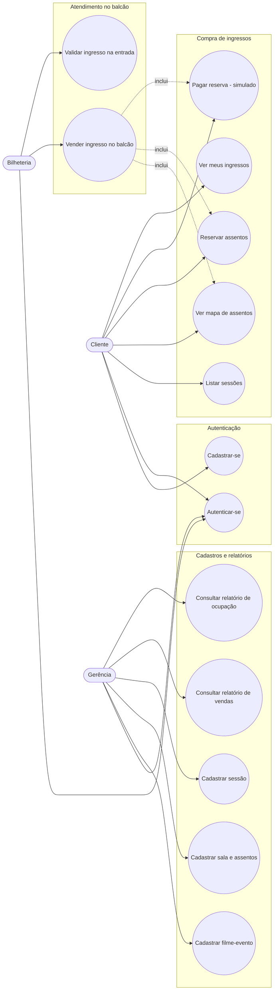

# Diagrama de Casos de Uso

Três atores, dois papéis de sistema (`CLIENTE` e `OPERADOR` — Bilheteria e Gerência usam o
mesmo papel `OPERADOR`, apenas em telas diferentes do mesmo app, conforme o enunciado).

## Descrição por ator

### Cliente
- **Cadastrar-se / Autenticar-se**: cria conta (sempre como cliente) ou faz login.
- **Listar sessões**: vê filmes/eventos com sessão futura (sala, data/hora, preço).
- **Ver mapa de assentos**: para uma sessão, vê todos os assentos da sala com status
  livre/reservado/vendido.
- **Reservar assentos**: seleciona um ou mais assentos livres; o sistema cria uma reserva
  temporária com prazo de expiração.
- **Pagar reserva**: confirma o pagamento (simulado) da reserva antes de expirar; o sistema
  emite um ingresso com código único por assento.
- **Ver meus ingressos**: lista os ingressos já emitidos, com código e status.

### Bilheteria (papel operador)
- **Vender ingresso no balcão**: mesmo fluxo do cliente (mapa de assentos → reserva →
  pagamento), realizado pelo atendente para uma venda presencial.
- **Validar ingresso na entrada**: busca um ingresso pelo código e marca como utilizado; um
  ingresso já utilizado não pode ser validado de novo.

### Gerência (papel operador)
- **Cadastrar filme/evento**: título, descrição e duração.
- **Cadastrar sala e assentos**: cria a sala e gera o conjunto fixo de assentos (fileiras x
  numeração); só pode ser feito uma vez por sala.
- **Cadastrar sessão**: associa um filme/evento a uma sala, define data/hora e preço.
- **Consultar relatório de vendas**: total vendido, ingressos emitidos e detalhamento por sessão.
- **Consultar relatório de ocupação**: percentual de assentos vendidos/reservados por sessão.

## Fluxos alternativos relevantes

- **Reserva expirada**: se o cliente não pagar dentro do prazo, a reserva expira
  automaticamente (trigger no banco) e o assento volta a ficar livre para qualquer cliente.
- **Disputa pelo mesmo assento**: se dois clientes tentarem reservar o mesmo assento da mesma
  sessão ao mesmo tempo, apenas um consegue; o outro recebe erro de conflito e deve escolher
  outro assento — garantido por transação com travamento (advisory lock) e índice único
  parcial no banco.
- **Ingresso já utilizado**: tentativa de validar novamente um ingresso já utilizado é rejeitada.
