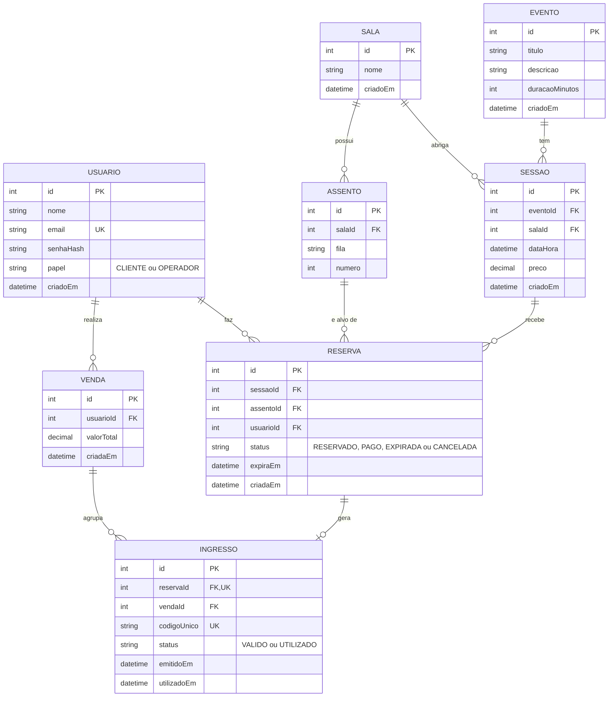

# Diagrama Entidade-Relacionamento

Modelo lógico implementado em `backend/prisma/schema.prisma` e materializado na migration
`backend/prisma/migrations/20261103000000_init/migration.sql`.

## Constraints e índices relevantes

- `ASSENTO`: `UNIQUE (salaId, fila, numero)` — não existem dois assentos iguais na mesma sala.
- `USUARIO.email`, `INGRESSO.codigoUnico`: `UNIQUE`.
- `INGRESSO.reservaId`: `UNIQUE` (relação 1:1 com `RESERVA`).
- **Regra central do negócio** — "um assento de uma sessão só pode ser vendido a um
  cliente": índice único **parcial**
  `UNIQUE (sessaoId, assentoId) WHERE status IN ('RESERVADO','PAGO')` em `RESERVA`. Reservas
  `EXPIRADA`/`CANCELADA` não contam, liberando o assento para nova reserva.
- Índices de apoio: `SESSAO(dataHora)`, `RESERVA(status, expiraEm)`, `RESERVA(sessaoId, assentoId)`.
- Trigger `trg_reserva_expira_antes_insert` expira reservas vencidas antes de cada novo INSERT
  em `RESERVA`.
- Stored procedure `confirmar_pagamento` cria a `VENDA` e os `INGRESSO` atomicamente a partir de
  uma ou mais `RESERVA`.
